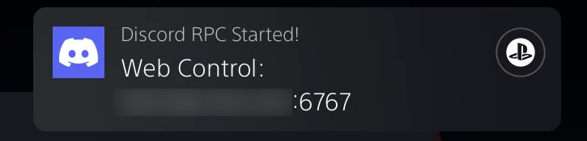
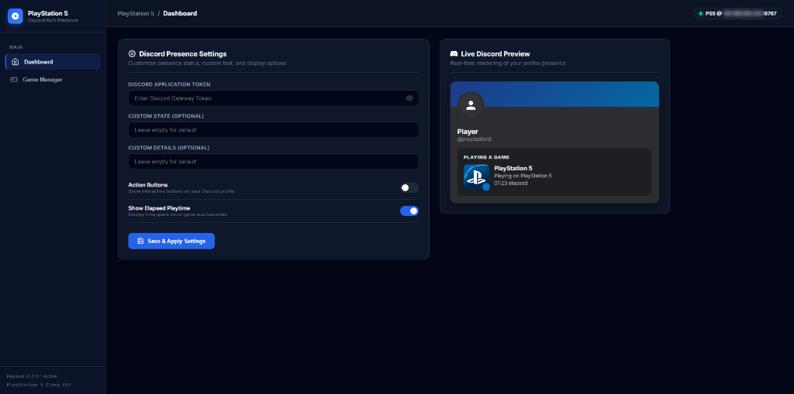
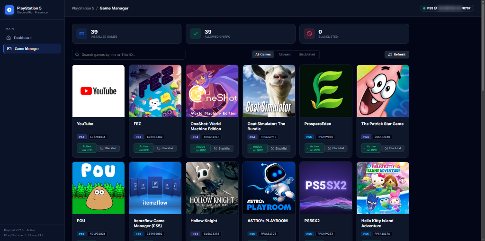
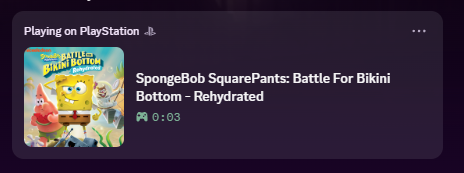

# PS5 Discord Rich Presence (RPC)

> **Disclaimer:** This project was created with the assistance of AI.

A native, zero-PC Discord Rich Presence background daemon for jailbroken PlayStation 5 consoles. Runs directly on your PS5—no companion PC or bridge app required.

---

## Features

- **100% Console Native:** Runs silently in the background as an ELF daemon.
- **Official PS5 Presence:** Displays "Playing on PlayStation 5" with the official console badge and game covers.
- **Automatic Icon Resolution & Upload:** Uploads each installed game's local `icon0.png` to Catbox once, then falls back to Sony TMDB / Steam artwork only when no local icon exists.
- **Smart Game Detection:**
  - Auto-clears Discord presence when a game closes (leaving your profile clean).
  - Restarts the playtime timer whenever you switch games.
- **PS5 Media App (DISC00001):**
  - Native installable PlayStation 5 Media application that sits right on your PS5 Home Screen under the **Media** tab.
  - Launches full-screen on your TV with complete controller navigation.
- **Multiple Discord Login Methods (No Token Mining Required):**
  - **QR Code Remote Auth:** Point your phone camera at the TV and tap "Log In" using the Discord Mobile app (`User Settings -> Scan QR Code`).
  - **Embedded Webview / Browser Login:** Log in via Discord Web in-app; the session token is automatically captured upon completion.
  - **Email + Password Login:** Sign in directly with email/phone and password, with full Two-Factor Authentication (2FA) prompt support.
  - **Manual Token Paste:** Direct token paste fallback.
- **In-Game Overlay UI ([Kabuki](https://github.com/stupiditytries/kabuki-ps5)):**
  - Native Control Center overlay tile accessible in any running game by holding **L3 + R3**.
  - On-screen controls for Discord Voice Chat (mute/unmute microphone, deafen audio, disconnect, channel selection) and Rich Presence toggles.
  - Smart status notifications: displays an on-screen alert on startup if Kabuki is not yet launched, and confirms once the overlay connects and is active.
- **Web Dashboard (`http://<PS5_IP>:6767`):**
  - Manage settings, customize status/buttons, and toggle games on/off.
  - Game Library view with one-click title blacklisting.
  - Live Discord card preview.
- **Single-Instance Protection:** Prevents duplicate payloads from running if already active.
- **Accurate Clock Sync:** Automatically synchronizes true UTC time over NTP/HTTPS so elapsed playtime timers never freeze.

---

## Quick Setup

### 1. Send the Payload
Make sure your PS5 is jailbroken and listening for payloads (e.g. port `9021`). Send `discord_rpc.elf`:

```bash
nc -q0 <PS5_IP> 9021 < discord_rpc.elf
```

A notification will pop up on your TV screen displaying your console's web dashboard address:



### 2. Log in & Configure (Choose your preferred way)

#### Option A: PS5 Media App (`DISC00001` - Auto-Installed by Payload!)
When you load `discord_rpc.elf`, the payload automatically installs the Discord Media App to your console storage (`/user/app/DISC00001`). You will see an on-screen notification:
> **"Installed Discord to Media Home Screen!"**

Simply switch to your PS5 **Media** tab on the Home Screen, open **Discord**, and scan the QR code or sign in using your controller! *(You can also trigger a manual reinstall at any time via `http://<PS5_IP>:6767/api/app/install`).*

#### Option B: Web Dashboard (`http://<PS5_IP>:6767`)
1. On your phone, PC, or console browser, open `http://<PS5_IP>:6767`.
2. Choose your login method:
   - **QR Code:** Open Discord on your phone, go to **User Settings &rarr; Scan QR Code**, and scan the screen.
   - **Webview Login:** Click **Open Discord Login Window** to sign in through Discord Web.
   - **Email + Password:** Enter your login credentials and 2FA code.
   - **Token Paste:** Paste your token directly.
3. Click **Save & Apply Settings**.





4. Launch any game—your Discord status updates instantly!



### 3. In-Game Controls via Kabuki Overlay (Optional)
If you have [Kabuki](https://github.com/stupiditytries/kabuki-ps5) installed:
- Hold **L3 + R3** on your DualSense controller inside any running game to open the overlay.
- Navigate to the **Discord** tile to:
  - Check current Voice Chat status and connected channel.
  - Toggle microphone mute or audio deafen directly from your controller.
  - Browse and connect to Discord voice channels.
  - View live game title and active Rich Presence timer.
- If the payload is loaded before Kabuki, an on-screen TV notification will remind you to start Kabuki. Once Kabuki is detected, a confirmation popup notifies you that in-game controls are ready.

---

## File Storage Locations

Configuration and cache files are stored permanently on console storage across reboots:

- `/data/discord_rpc/config.json` — User settings (token, buttons, toggles, blacklist)
- `/data/discord_rpc/icon_cache.json` — Per-title Catbox upload cache (title ID → uploaded icon URL)

*(Fallback: `/user/home/discord_rpc/` is used automatically if `/data` is not accessible).*

---

## Building from Source

Requires the [PS5 Payload SDK](https://github.com/ps5-payload-dev/sdk).

```bash
make
```

*(Optionally specify the SDK path if installed outside `/opt/ps5-payload-sdk`)*:
```bash
make PS5_PAYLOAD_SDK=/path/to/ps5-payload-sdk
```

The compiled binary will be generated as `discord_rpc.elf`.

---

## Credits & Acknowledgements

- **[stupiditytries/kabuki-ps5](https://github.com/stupiditytries/kabuki-ps5)** — In-game ShellUI Control Center overlay hub for PS5 homebrew.
- **[notmaj0r/ProsperoMgr](https://github.com/notmaj0r/ProsperoMgr)** — Game detection logic and web interface design.
- **[SirHumza/orbisRPC](https://github.com/SirHumza/orbisRPC)** — Original PS4 Discord RPC daemon, protocol reference, and network engine.
- **[ps5-payload-dev / sdk](https://github.com/ps5-payload-dev/sdk)** — Native PS5 payload SDK and toolchain.
- **[Catbox.moe](https://catbox.moe)** — Public image hosting for on-console icon uploads.
